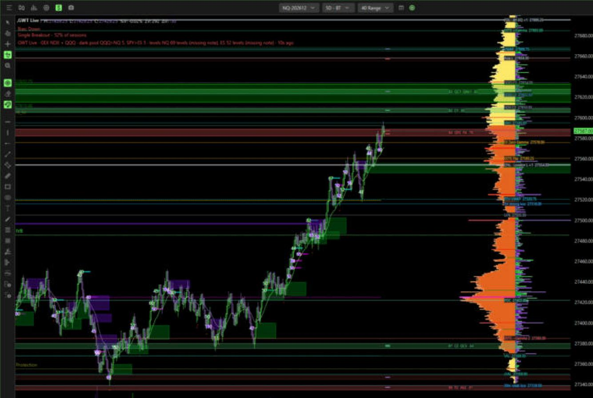
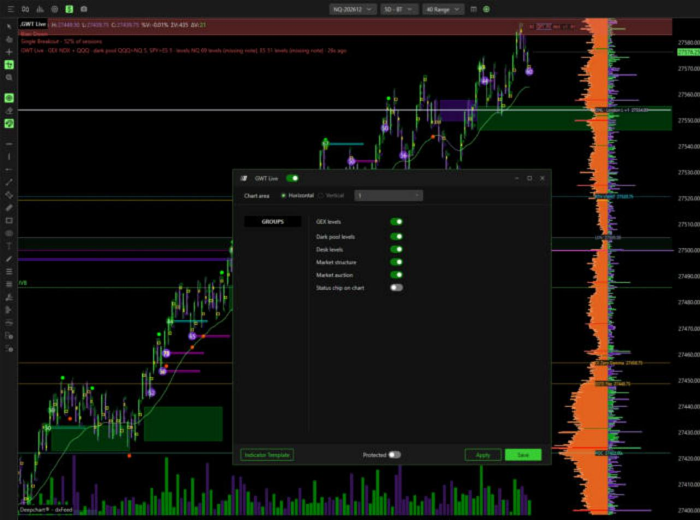

# GWT Deepchart Bridge

Puts GWT's live levels on your Deepchart charts (NQ, MNQ, ES, MES) and keeps them current by itself.

The **GWT Live** indicator draws:
- **GEX levels**: GWT's ranked NDX + QQQ 0DTE levels as Conviction Blocks, like GWT's ATAS indicator (NQ / MNQ only).
- **Dark pool levels**: the top 5 of the last three sessions, QQQ's on NQ and SPY's on ES, at futures prices.
- **Desk, Market Structure and Market Auction** levels and zones (what ATAS's Level Importer shows).



*GWT Live on NQ (40 range bars): GEX Conviction Blocks as green (positive gamma) and red (negative gamma) bands with
their pills (`B1 QC1 QAb1 .92`: rank, leading levels, score), the desk / structure / auction levels with labels on the
right, and the strike ticks just right of the last bar.*



*GWT Live on an NQ chart with its settings window: one switch per group (GEX, dark pool, desk, market structure,
market auction). The status line at the top left shows what is drawn and how fresh it is.*

## How it works (one paragraph)
Deepchart does not let indicators go online, so a small program, the **bridge**, does it for them. It runs in the
system tray, fetches GWT's data with your token, builds an indicator file (`GwtLive.dll`) with the current levels inside,
and puts it in Deepchart's Indicators folder. To make an open chart pick up the new file, it briefly opens that chart's
**Indicators** tab and toggles GWT Live's eye (hide, show). It never moves your mouse or types: you just see the
Indicators tab appear for about half a second, only on charts that have GWT Live.

## What you need
- Windows and Deepchart (installed and logged in).
- Your **GWT token**: the same one you paste into GWT's ATAS indicator (GWT desktop app, ATAS Indicator view).
- Your **Deepchart developer id**. Deepchart only loads a local indicator built for your account. Deepchart does not
  show this id in the app yet: **ask Deepchart support for your developer id**. It looks like
  `xxxxxxxx-xxxx-xxxx-xxxx-xxxxxxxxxxxx`.

## Install (once)
1. Get `GwtDeepchartBridge.zip` (on GitHub: the **Releases** page, right side of the repo page) and unzip it somewhere
   permanent, for example `C:\Tools\GwtDeepchartBridge`. Keep all files together.
   (The `src` folder is the source code, only needed to build it yourself: see **Build from source**.)
2. Double-click `GwtDeepchartBridge.exe`. A settings window opens:
   - **GWT token**: paste it. It is stored encrypted for your Windows user only and is never shown or logged.
   - **Deepchart developer id**: paste the id from Deepchart support.
   - **Deepchart install folder**: leave the default (`C:\Program Files\Volumetrica Trading\Deepchart\`) unless you
     installed Deepchart elsewhere.
   - Press **Save**. The bridge now runs in the system tray (bottom right, next to the clock; it may be under the ^ arrow).
3. In Deepchart, open an NQ, MNQ, ES or MES chart, open the indicator list and add **GWT Live**.
4. Right-click the tray icon and tick **Start with Windows**, so the bridge is always running.

That's it. Within a minute or two GWT Live shows the levels, and from then on it updates by itself.

## Using it
- Just trade. When GWT's levels change, the bridge refreshes GWT Live, at most once every 2 minutes, and at least every
  15 minutes even when nothing changed.
- It **waits until you stop clicking or typing for 3 seconds** before it refreshes, so the Indicators tab never pops up
  under a click.
- **GWT Live's status line** (top left of the chart) says what it shows and how old it is, for example
  `GWT Live · GEX NDX + QQQ · dark pool QQQ>NQ 5, SPY>ES 5 · levels NQ 68 levels · 40s ago`.
- **Switch groups on or off** in GWT Live's settings: GEX, dark pool, desk, market structure, market auction.
- **More than one chart:** add GWT Live to each chart you want. Charts without GWT Live are never touched.
  If you add GWT Live to another chart later, it shows the current levels at once; to make the bridge keep refreshing it
  too, right-click the tray icon and press **Refresh charts now** once.

## Tray menu (right-click the icon)
| Item | What it does |
|---|---|
| (status line) | What the bridge is doing right now. |
| Refresh charts now | Refreshes now and re-checks every chart for GWT Live. |
| Settings… | Change token, developer id or Deepchart folder. |
| Start with Windows | Run the bridge at every Windows start. |
| Open log | The bridge's log (no token in it). Send it along when you report a problem. |
| Quit | Stops the bridge. GWT Live keeps the last levels but stops updating. |

## What the status means
| GWT Live status line | Meaning |
|---|---|
| `GEX NDX + QQQ` | GEX levels are live. |
| `GEX NDX no levels` / `QQQ ratio stale` | Normal outside market hours. |
| `bridge not updating (… old)` | No refresh for 30 minutes: the bridge is not running. Double-click `GwtDeepchartBridge.exe` in its folder. |
| `(missing note)` after the levels | GWT's server has no data for that group right now. The others draw normally. |
| `NQ, MNQ, ES or MES charts only` | GWT Live is on a chart of another instrument. |

## Troubleshooting
- **GWT Live is not in Deepchart's indicator list:** the developer id is wrong or missing (tray → Settings…), or the bridge
  has not run yet. Restart Deepchart after fixing it.
- **The levels never update:** check the tray icon is there, then tray → Open log. `rejected: invalid token` means the token
  is wrong; `replaced by a newer connection` means your token was used on another network (see Limits).
- **The Indicators tab stays open:** close it with a click and send the log lines that say `did not close`.
- **Labels overlap** where levels are close together: Deepchart gives indicators no text sizes, so they cannot be spread
  out the way ATAS does.

## Limits
- GWT allows one network per token, up to 25 charts. The bridge counts as one connection, like one ATAS chart, so ATAS
  and the bridge can run together on the same PC.
- If a Deepchart update changes the Indicators tab, the bridge stops refreshing (the status line goes stale) rather than
  press anything else. It only ever presses GWT Live's eye, after checking the row looks like
  `delete | GWT Live | eye | settings`.

## Uninstall
Tray → Quit, untick Start with Windows first if you ticked it. Delete the bridge folder,
`%APPDATA%\GwtDeepchartBridge` (settings, encrypted token, log) and `Documents\Deepchart\Indicators\GwtLive.dll`.

## Build from source
The full source is in the `src` folder of this package.

**You need:** Windows and the [.NET 10 SDK](https://dotnet.microsoft.com/download/dotnet/10.0) (x64). Deepchart is
only needed to run it, not to build it.

1. Open a terminal in the `src` folder.
2. Build:
   ```
   dotnet build -c Release GwtDeepBridge.csproj
   ```
   The program is `bin\Release\GwtDeepchartBridge.exe`. The build also copies .NET's reference assemblies into
   `bin\Release\ref`: the bridge compiles GWT Live with them on your PC, so keep that folder next to the exe.
3. Check it (offline: parsers plus a real compile of GWT Live, nothing is deployed and GWT is not contacted):
   ```
   bin\Release\GwtDeepchartBridge.exe --selfcheck
   ```
   It prints `SelfCheck OK`.
4. Run `bin\Release\GwtDeepchartBridge.exe` (inside `src`) and continue with **Install** step 2 above.

**What is where**
| File | What it does |
|---|---|
| `Program.cs` | Tray icon, menu, settings window, `--selfcheck`. |
| `Bridge.cs` | The loop: fetch data, decide when to refresh, idle guard; settings and the DPAPI-encrypted token. |
| `Shared\GwtFeed.cs`, `Shared\GwtProtocol.cs` | GWT's live GEX WebSocket feed and its messages. |
| `Shared\GwtBlocks.cs`, `Gex.cs` | GEX levels clustered into Conviction Blocks, turned into drawing items. |
| `DarkPool.cs`, `LevelImport.cs` | GWT's dark pool and level-import endpoints, turned into drawing items. |
| `LiveItem.cs` | One drawing item (box, line, text, level) and how it is written into the indicator's code. |
| `Template\GwtLive.cs` | The Deepchart indicator. The bridge compiles it with the current items baked in. |
| `Compiler.cs` | Compiles that indicator in memory (Roslyn) with your developer id and puts it in Deepchart's Indicators folder. |
| `Reloader.cs` | Refreshes open charts through Windows UI Automation: opens a chart's Indicators tab, toggles GWT Live's eye, closes the tab. |

**Why it is built this way.** Deepchart checks every indicator before loading it and refuses any that use the network,
files, threads, reflection, `decimal` constants, records or constant arrays. So the data is baked into the indicator's
code instead of fetched by it. A rebuilt indicator only reaches charts that add it afresh; an indicator cannot reload
itself, so the bridge toggles its eye from outside. Deepchart only draws boxes and lines at bar positions (text can use
a fraction of the chart width), and its Indicators tab button only opens the tab: the bridge closes it by sending the
tab's window `WM_CANCELMODE`, the message that makes a popup let go of the mouse.
